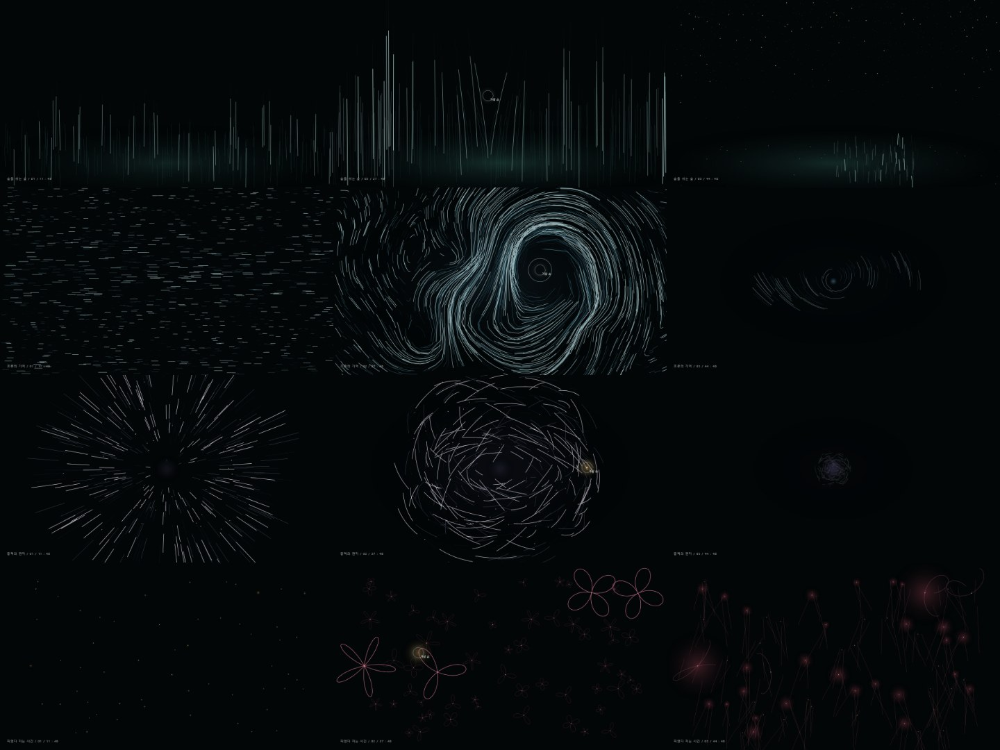

# media-art — 추상의 네 장면

전시장 벽면 LED·프로젝션에 상영될 **실시간 인터랙티브 미디어아트**의 방향을 정하는 웹 시제품입니다. 숲 / 바다 / 우주 / 꽃밭 네 작품이 각각 48초, 3막으로 하나의 생각을 이야기하고, 관람객의 손(마우스·터치)에 반응합니다. 최종 구현은 Unreal Engine 5이며, 이 시제품은 UE 8개 표현 계열 안에서만 연출합니다([BRIEF.md](BRIEF.md)).

<p align="center"></p>
<p align="center"><sub>행: 숲 · 바다 · 우주 · 꽃밭 / 열: 1막(9초) · 2막(25초) · 3막(41.5초)</sub></p>

## 보는 법

```bash
npx vite media-art --port 5180     # 저장소 루트에서. http://localhost:5180
```
`index.html`을 브라우저로 바로 열어도 됩니다(단일 파일, 외부 파일 없음).

| 조작 | 키 |
|---|---|
| 재생·정지 | 스페이스 |
| 작품 이동 | ← / → |
| 막 이동 | 1 / 2 / 3 |

손이 2초 넘게 없으면 2막 동안 "가상 손"이 반응을 시연합니다.

## 파일

| 파일 | 내용 |
|---|---|
| [index.html](index.html) | **현재 작품** (Codex 제작, 4라운드) |
| [NOTES.md](NOTES.md) | 작품별 요약 표: 컨셉 · 손의 의미 · 3막 · 시각 언어 · UE 계열 · 손 반응 수치, 라운드별 변경 이력 |
| [claude-v2.html](claude-v2.html) | Claude 시안 (비교용) |
| [BRIEF.md](BRIEF.md) | 브리프 (공개용으로 회사·인명 정보를 뺀 요약) |
| [prompts/](prompts) | 라운드별 연출 지시 원문 |
| [check/shoot.mjs](check/shoot.mjs) | 자동 검증 |
| [shots/](shots) | 라운드별 접촉 시트 |

## 작업 방식: 디렉터 → 제작 → 자동 검증 → 다시 지시

```
Claude(디렉터) ─ 연출 프롬프트 ─▶ Codex(제작) ─ index.html ─▶ 자동 검증(Playwright)
      ▲                                                          │
      └──────── 접촉 시트 · fps · 오류를 보고 다음 지시 작성 ◀─────────┘
```

1. **연출 프롬프트** — 브리프와 직전 라운드 결과를 바탕으로 디렉터가 `prompts/NN_*.md`를 쓴다.
2. **제작** — Codex가 같은 대화 스레드에서 `index.html`과 `NOTES.md`를 고친다.
3. **자동 검증** — `node media-art/check/shoot.mjs`가 아래를 재고 합격·불합격으로 끝난다(종료 코드 0/1).
4. 통과한 결과만 커밋한다(autocommit).

| 검증 항목 | 합격선 |
|---|---|
| 콘솔 오류 | 0 |
| 12장면(4작품 × 3막) fps | 모두 55 이상 |
| 막 버튼 진입 시각 오차 | 0.05초 미만 |
| 실제 2초 동안 작품 시계 | 2.0 ± 0.1초 |
| 48초 뒤 다음 작품 전환 | 꽃밭 → 숲 순환 |
| 폭 400px 가로 넘침 | 없음 |

```bash
node media-art/check/shoot.mjs                      # index.html → shots/latest/
node media-art/check/shoot.mjs claude-v2.html shots/v2
```

## 라운드 이력

| 라운드 | 결과 | 다음 지시의 핵심 |
|---|---|---|
| [1](prompts/01_create.md) | 기술 만점(60fps, 오류 0)이지만 화면이 어둡고 성김, 꽃이 클립아트, 막 변화가 안 읽힘 | 밀도·광량, 막별 구도 차이, 꽃 아이콘 금지, 컨셉 문장 복원 |
| [2](prompts/02_direct.md) | 바다·우주가 작품 수준으로 올라옴. 숲은 청록 벽, 꽃은 각진 곡선. **숲 7fps** | 성능 최우선, 시간 오차(2.22초) 수정, 숲 재연출 |
| [3](prompts/03_direct.md) | 11장면 60fps, 시간 정확. 네 작품 모두 막 변화가 읽힘 | 바다 2막 49fps, 숲 호흡 띠, 꽃 색 관계 |
| [4](prompts/04_direct.md) | **모든 검증 통과(최저 59fps)**. 꽃이 장미 곡선 위주로 정돈됨 | 남은 과제: 숲의 숨 띠가 아직 약함 |

## 남은 과제
- 숲 2막의 "숨이 건너가는 밝은 띠"를 더 분명하게.
- 실제 손(카메라 추적)이 아닌 마우스로만 검증했다. UE 이식 전 손 반응 수치는 전시장 거리·해상도 기준으로 다시 잡아야 한다.
