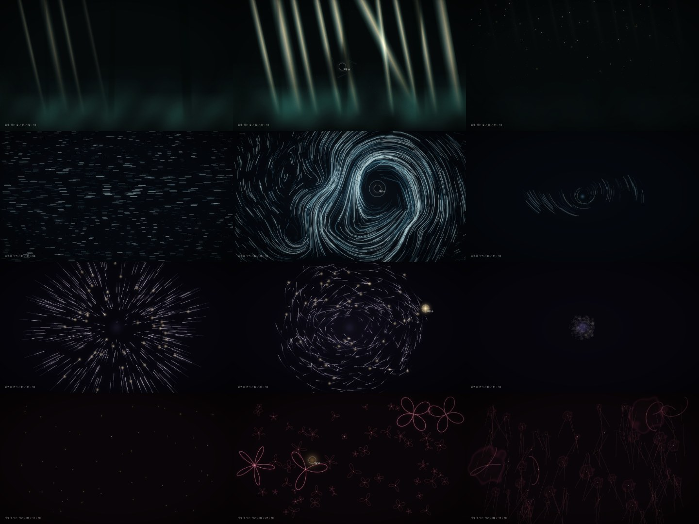

# media-art — 추상의 네 장면

전시장 벽면 LED·프로젝션에 상영될 **실시간 인터랙티브 미디어아트**의 방향을 정하는 웹 시제품입니다. 숲 / 바다 / 우주 / 꽃밭 네 작품이 각각 48초, 3막으로 하나의 생각을 이야기하고, 관람객의 손(마우스·터치)에 반응합니다. 최종 구현은 Unreal Engine 5이며, 이 시제품은 UE 8개 표현 계열 안에서만 연출합니다([BRIEF.md](BRIEF.md)).

<p align="center"></p>
<p align="center"><sub>행: 숲 · 바다 · 우주 · 꽃밭 / 열: 1막(9초) · 2막(25초) · 3막(41.5초)</sub></p>

## 보는 법

```bash
npx vite media-art --port 5180     # 저장소 루트에서. http://localhost:5180
```
`index.html`을 브라우저로 바로 열어도 됩니다(단일 파일, 외부 파일 없음).

| 조작 | 키 |
|---|---|
| 재생·정지 | 스페이스 |
| 작품 이동 | ← / → |
| 막 이동 | 1 / 2 / 3 |

손이 2초 넘게 없으면 2막 동안 "가상 손"이 반응을 시연합니다.

## 팀 갤러리 — 작품 올리고 같이 보기

```bash
npm run media:gallery        # http://127.0.0.1:5190
```

- **작품 올리기**: 제목·작성자·테마·설명과 파일(HTML, MP4, WebM, MOV, GIF, PNG, JPG, WebP / 파일당 45MB, 최대 6개)을 올리면 `media-art/gallery/<시각>-<제목>/`에 `meta.json`과 함께 저장됩니다.
- **공유**: 이 폴더는 autocommit이 켜져 있어 올린 파일이 자동으로 커밋·푸시됩니다. 다른 팀원은 `git pull` 후 자기 갤러리를 새로고침하면 같은 목록을 봅니다.
- **공식 결과물**: 현재 작품, Claude 시안, `renders/`의 렌더 결과가 자동으로 맨 위에 걸립니다.
- 올린 HTML은 격리된 iframe(`sandbox="allow-scripts"`)에서 실행됩니다. 서버는 이 컴퓨터(127.0.0.1)에서만 열립니다.

## 영상·GIF·스틸로 뽑기

```bash
npm run media:render                 # 4작품 전부 (작품당 약 12분)
npm run media:render -- index.html 1 # 바다만
```

가상 시계로 1/30초씩 정확히 넘기며 찍기 때문에 기기 성능과 상관없이 끊김 없는 결과가 나옵니다. 가상 손이 2막에서 반응을 시연하는 모습도 그대로 담깁니다.

| 결과 (`renders/<작품>/`) | 내용 | git |
|---|---|---|
| `<작품>.mp4` | 48초 전체, 1920×1080 30fps, H.264 (약 35MB) | 올리지 않음(용량) — 렌더한 PC의 갤러리에서 보거나 직접 공유 |
| `preview.mp4` | 2막 22~28초 미리보기, 640px (약 1MB) | 올림 |
| `highlight.gif` | 2막 22~26초, 480px 10fps 48색 (약 2~3MB) | 올림 |
| `act1.jpg` ~ `act3.jpg` | 막별 스틸 1920×1080 (9초 · 25초 · 41.5초) | 올림 |

## 파일

| 파일 | 내용 |
|---|---|
| [index.html](index.html) | **현재 작품** (Codex 제작, 10라운드) |
| [NOTES.md](NOTES.md) | 작품별 요약 표: 컨셉 · 손의 의미 · 3막 · 시각 언어 · UE 계열 · 손 반응 수치, 라운드별 변경 이력 |
| [claude-v2.html](claude-v2.html) | Claude 시안 (비교용) |
| [BRIEF.md](BRIEF.md) | 브리프 (공개용으로 회사·인명 정보를 뺀 요약) |
| [prompts/](prompts) | 라운드별 연출 지시 원문 |
| [check/shoot.mjs](check/shoot.mjs) | 자동 검증 |
| [shots/](shots) | 라운드별 접촉 시트 |

## 작업 방식: 디렉터 → 제작 → 자동 검증 → 다시 지시

```
Claude(디렉터) ─ 연출 프롬프트 ─▶ Codex(제작) ─ index.html ─▶ 자동 검증(Playwright)
      ▲                                                          │
      └──────── 접촉 시트 · fps · 오류를 보고 다음 지시 작성 ◀─────────┘
```

1. **연출 프롬프트** — 브리프와 직전 라운드 결과를 바탕으로 디렉터가 `prompts/NN_*.md`를 쓴다.
2. **제작** — Codex가 같은 대화 스레드에서 `index.html`과 `NOTES.md`를 고친다.
3. **자동 검증** — `node media-art/check/shoot.mjs`가 아래를 재고 합격·불합격으로 끝난다(종료 코드 0/1).
4. 통과한 결과만 커밋한다(autocommit).

측정은 브리프의 성능 목표(노트북 내장 그래픽 60fps)에 맞춰 **실제 GPU**로 합니다. 이 PC에서는 Intel Iris Xe(D3D11)입니다. 기본 헤드리스 Chromium은 GPU 없는 SwiftShader라 CSS 합성이 CPU로 돌아 실제보다 훨씬 느리게 잽니다(`CHECK_SOFTWARE=1`로 그 조건 재현).

| 검증 항목 | 합격선 |
|---|---|
| 콘솔 오류 | 0 |
| 12장면(4작품 × 3막) fps | 모두 55 이상 |
| 막 버튼 진입 시각 오차 | 0.05초 미만 |
| 실제 2초 동안 작품 시계 | 2.0 ± 0.1초 |
| 48초 뒤 다음 작품 전환 | 꽃밭 → 숲 순환 |
| 폭 400px 가로 넘침 | 없음 |
| 블랙 레벨(장면 위쪽 모서리 평균 밝기, 0~255) | 14 이하 |

```bash
node media-art/check/shoot.mjs                      # index.html → shots/latest/
node media-art/check/shoot.mjs claude-v2.html shots/v2
node media-art/check/profile.mjs media-art/index.html 1 25   # 바다(1) 25초 장면의 병목 프로파일
```

## 라운드 이력

| 라운드 | 결과 | 다음 지시의 핵심 |
|---|---|---|
| [1](prompts/01_create.md) | 기술 만점(60fps, 오류 0)이지만 화면이 어둡고 성김, 꽃이 클립아트, 막 변화가 안 읽힘 | 밀도·광량, 막별 구도 차이, 꽃 아이콘 금지, 컨셉 문장 복원 |
| [2](prompts/02_direct.md) | 바다·우주가 작품 수준으로 올라옴. 숲은 청록 벽, 꽃은 각진 곡선. **숲 7fps** | 성능 최우선, 시간 오차(2.22초) 수정, 숲 재연출 |
| [3](prompts/03_direct.md) | 11장면 60fps, 시간 정확. 네 작품 모두 막 변화가 읽힘 | 바다 2막 49fps, 숲 호흡 띠, 꽃 색 관계 |
| [4](prompts/04_direct.md) | 모든 검증 통과(최저 59fps). 꽃이 장미 곡선 위주로 정돈됨 | 이미지 퀄리티 |
| [5](prompts/05_image_quality.md) | 블룸·필름 그레인·별 스프라이트·수묵 얼룩으로 이미지가 풍부해짐. 대신 배경이 회색으로 뜨고(블랙 레벨 21.5) 바다 2막 29fps | 검정 복원, 블룸 비용, 꽃 얼룩 모양 |
| [6](prompts/06_fix.md) | 블랙 레벨 9.4로 복원, 얼룩이 물감 번짐으로. 성능은 더 나빠짐 | 화면 전체 합성을 CSS 레이어로 |
| [7](prompts/07_perf.md) | 소프트웨어 렌더링 측정에서는 더 느려 보였으나, **실제 GPU(Iris Xe)로 재니 가장 빠름**. 측정 환경을 GPU로 바로잡음 | 바다 2막 29fps |
| [8](prompts/08_sea.md) | 속도장 격자를 넣었지만 바다 2막 그대로 | 프로파일링 |
| [9](prompts/09_readback.md) | 프로파일 결과 프레임의 77%가 블룸의 `getImageData`(GPU→CPU 동기 복사). 픽셀 읽기를 없애고 임계값을 CSS 필터로 → 프레임당 JS 17.9ms → 1.0ms. 모든 검증 통과(최저 56fps, 블랙 레벨 5.8) | 1080p 렌더로 보니 숲이 비·바코드처럼 보임 |
| [10](prompts/10_forest.md) · [10b](prompts/10b_fix.md) · [10c](prompts/10c_trunks.md) | 숲을 **빛줄기와 안개(고모레비)**로 재설계. 실행 오류(`drawImage`)와 딱딱한 나무 기둥 마스크를 고침. 오류 0, 막 점프·시간·모바일·블랙 레벨(4.9) 합격 | — |

## 남은 과제
- **바다 2막은 내장 그래픽에서 GPU 한계 장면**이다. JS는 프레임당 약 1.3ms(87% 유휴)인데, 같은 GPU를 쓰는 다른 프로그램 부하에 따라 40~56fps를 오간다(`node media-art/check/profile.mjs media-art/index.html 1 25`로 확인). UE 이식 때 궤적 입자 수(현재 상한 2000)와 잔상 합성 비용을 먼저 잡아야 한다.
- 실제 손(카메라 추적)이 아닌 마우스로만 검증했다. UE 이식 전 손 반응 수치는 전시장 거리·해상도 기준으로 다시 잡아야 한다.
